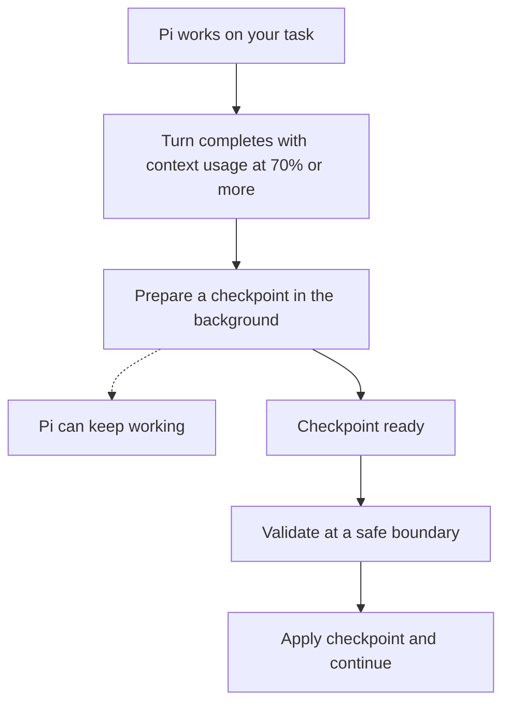

# pi-background-compaction

Reduce compaction pauses and keep your coding tasks moving by preparing checkpoints in the background. When compaction is needed, Pi can reuse a prepared checkpoint instead of starting from scratch.

English | [简体中文](README.zh-CN.md)

Background preparation and automatic application are on by default. It may consume provider quota even if the checkpoint is never used. It can reduce waiting, but does not guarantee faster or cheaper compaction.

## Install

This is an optional companion to a compatible compaction engine, such as [pi-codex-compact](https://github.com/AHGGG/pi-extensions/tree/main/packages/pi-codex-compact). The companion decides when to prepare and apply a checkpoint. The engine handles provider requests, checkpoint validation, and recovery.

1. Install or update a compatible compaction engine. Follow the [pi-codex-compact setup instructions](https://github.com/AHGGG/pi-extensions/tree/main/packages/pi-codex-compact) and keep its extension enabled.
2. Install this companion:

   ```sh
   pi install git:github.com/AHGGG/pi-background-compaction@master
   ```

3. Restart Pi.

Use a current engine version that supports the separate background companion. Do not run an older built-in background controller alongside this extension. If Pi reports that no compatible engine is installed, update the engine and restart; this package cannot prepare checkpoints on its own.

Removing this companion does not remove the engine's manual compaction or checkpoint replay features.

## Get started

After installation, background preparation, **Apply when ready**, and progress notices are enabled by default. Run `/background-compaction` and open **Settings** to change them.

After a completed turn, preparation can start when context usage reaches the configured threshold, which defaults to 70%. You can keep working while it runs.

There are two ways to use a prepared checkpoint:

- **Turn Apply when ready off:** the checkpoint waits for manual `/compact` or Pi's automatic compaction.
- **Leave Apply when ready on (default):** the extension can apply it after the current model/tool batch or at the next idle input boundary, once validation succeeds.

A **Ready** checkpoint has been prepared, not yet written into the session. Changes to the session, model, provider, tools, or relevant settings can make it unusable. The engine checks it before applying it.

## How it works

With the default settings:



A safe boundary is after the current model/tool batch or at the next idle input boundary, not in the middle of an active request. If actual compaction starts before preparation finishes, it waits for compatible background work. If that work fails or cannot be used, the engine runs compaction in the foreground.

## Manual and automatic compaction

If a compatible checkpoint is still being prepared, plain `/compact` waits for it, just as Pi's automatic compaction does. A **Preparing** status during this wait is expected. If preparation or validation fails, the engine handles compaction in the foreground instead.

- Press Escape to cancel the wait. Cancellation does not apply the checkpoint or start a replacement request.
- Custom instructions passed to `/compact` replace the pending background work so the new instructions are respected.
- If the Pi host cancels an active run before dispatching `/compact`, work already cancelled by that action cannot be reused.

With **Apply when ready** enabled, a ready checkpoint is not applied during a failed model request or its retry. After a successful completed turn, it can be applied if it is still valid. Explicit cancellation prevents automatic application of that checkpoint; manual `/compact` remains available.

## Commands

| Command | Action |
| --- | --- |
| `/background-compaction` | Open Settings, Status, and Help in the terminal UI. |
| `/background-compaction resume` | Clear a failure pause for this session. Preparation can start after the next completed turn. |
| `/compact` | Run Pi's compaction, reusing compatible background work when available. |

In RPC mode with UI support, `/background-compaction` reports the settings file path instead of opening a menu. The menu is not available in print or JSON mode. The `resume` command does not require the menu.

## Settings

Settings are stored in `pi-background-compaction.json` inside Pi's agent directory, normally `~/.pi/agent/pi-background-compaction.json`.

| Setting | Default | Meaning |
| --- | --- | --- |
| `asyncEnabled` | `true` | Allow background checkpoint preparation. |
| `asyncAutoApply` | `true` | Apply ready checkpoints without waiting for ordinary compaction. Requires background preparation to be enabled. |
| `asyncThresholdPercent` | `70` | Context usage percentage that allows preparation. Must be an integer from 1 to 99. |
| `logCompaction` | `true` | Show preparation and application notices. |

Menu changes are saved and take effect immediately. Escape closes the menu; it does not undo saved changes. If you edit the file yourself, run `/reload` to load it. Invalid settings files disable background preparation and are not overwritten; repair the file and reload.

These are user-level settings, with no project overrides. Provider timeouts, retries, checkpoint retention, and recovery options belong to the compaction engine, not this companion.

### Moving from the built-in controller

Background settings and the resume command have moved from `/codex-compact` to `/background-compaction`.

If the new settings file does not exist, this extension reads the four settings above from the adjacent `pi-codex-compact.json`. Status shows when those legacy preferences are in use. The first explicit save in the new menu copies them into the new file, without changing the old file or copying provider credentials.

Once the new file exists, it takes precedence. Explicit saved values, including `false` and older thresholds, are preserved. Missing fields in either file use the defaults above; missing fields in the new file do not fall back to the old file. Keep your old settings until you have saved the new ones.

## Failures and limits

A failed preparation request pauses further preparation for the current session. Preparation failure warnings include elapsed time and a safe reason from the engine, or a generic message if no safe reason is available. Manual `/compact` and Pi's automatic compaction remain available.

Use `/background-compaction resume` when you want to try background preparation again. This clears the pause; it does not immediately send a provider request.

A checkpoint can also be discarded because the session changed or it no longer fits. Discarding an outdated checkpoint is not the same as a provider failure. Automatic application will not silently send a new provider request to replace an invalid checkpoint.

This extension does not add provider support or credentials. Requests use the compatible engine's existing provider route and authentication. Install only extensions and engines you trust. Check the engine's documentation for its data handling, supported providers, and recovery behavior.

## Development

```sh
npm install
npm run check
npm test
```

Run integration tests against a local, compatible `pi-extensions` checkout:

```sh
npm run test:integration -- /path/to/pi-extensions
```

To load the local extension in Pi:

```sh
pi -e ./src/index.ts
```

## License

[MIT](LICENSE). The original Narumi copyright notice is preserved.
