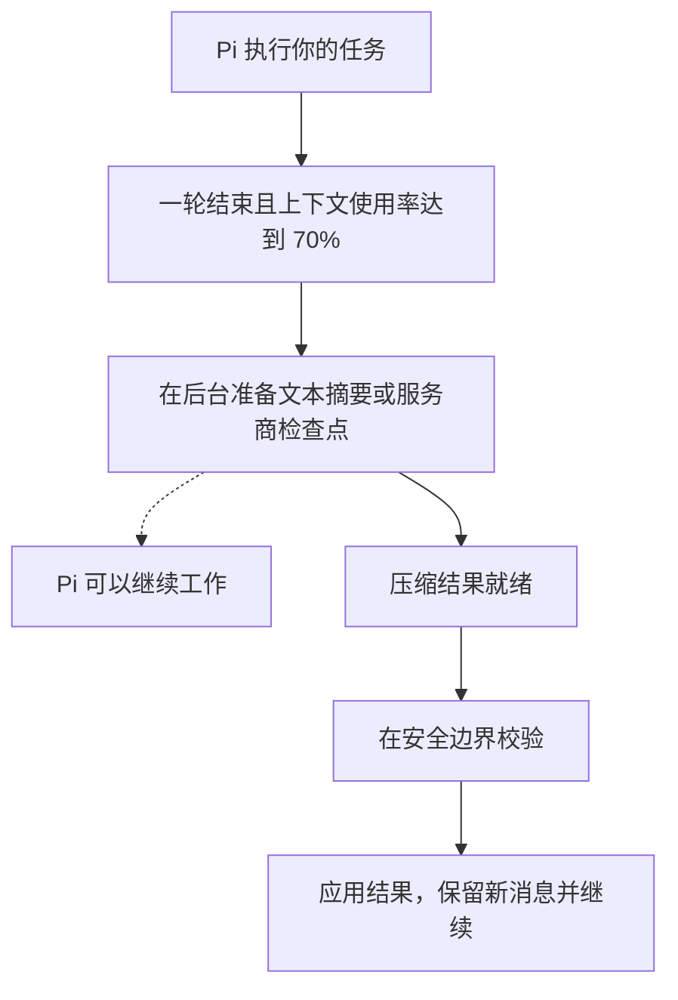

# pi-background-compaction

在后台提前准备压缩结果，减少上下文压缩带来的等待，让编码任务更顺畅地推进。需要压缩时，Pi 可以复用准备好的结果，而不必从头开始。

[English](README.md) | 简体中文

后台准备和自动应用默认开启。即使检查点最终没有使用，准备过程也可能消耗服务商配额。它可以减少等待，但不保证每次压缩都更快或更便宜。

## 安装

本扩展需要配合兼容的压缩引擎使用，例如 [pi-codex-compact](https://github.com/AHGGG/pi-extensions/tree/main/packages/pi-codex-compact)。本扩展决定何时准备和应用检查点；引擎负责向服务商发送请求、校验检查点和执行恢复流程。

1. 安装或更新兼容的压缩引擎。按照 [pi-codex-compact 的安装说明](https://github.com/AHGGG/pi-extensions/tree/main/packages/pi-codex-compact)操作，并保持引擎扩展启用。
2. 安装本扩展：

   ```sh
   pi install git:github.com/AHGGG/pi-background-compaction@master
   ```

3. 重启 Pi。

请使用支持独立后台扩展的新版引擎，不要同时运行旧版内置的后台控制器。如果 Pi 提示未安装兼容引擎，请更新引擎并重启。本扩展无法单独准备检查点。

移除本扩展不会移除引擎的手动压缩或检查点重放功能。

## 开始使用

安装后，后台准备、**Apply when ready（准备好后应用）**和进度提示默认开启。运行 `/background-compaction`，打开 **Settings（设置）**即可修改。

每轮结束后，如果上下文使用率达到设置的阈值，就可以开始准备检查点，默认阈值为 70%。准备期间，你可以继续工作。

准备好的检查点有两种使用方式：

- **关闭 Apply when ready：** 等到手动执行 `/compact` 或 Pi 自动触发压缩时再使用。
- **保持 Apply when ready 开启（默认）：** 校验通过后，扩展可以在当前模型/工具批次结束后，或下一个空闲输入边界应用检查点。

**Ready（就绪）**表示检查点已准备好，但尚未写入会话。会话、模型、服务商、工具或相关设置的变化都可能使其失效。引擎会在应用前检查它是否仍然可用。

## 选择输出格式

本扩展负责安排后台任务，压缩引擎决定准备哪种结果。更新 `pi-codex-compact` 后，打开 `/codex-compact` → **Settings**，将压缩模式设为 **Text summary（文本摘要）**或 **Provider checkpoint（服务商检查点）**：

- **Text summary：** 用普通模型请求总结已捕获的历史，并加入 scratchpad 指引。准备摘要时，主代理可以继续工作。
- **Provider checkpoint（默认）：** 请求服务商生成加密、不透明的检查点。

在 `/background-compaction` 中保持 **Apply when ready** 开启，两种结果都会在下一个安全边界自动应用。准备阶段不会替换当前历史；应用时只替换已总结的前缀，保留安全的近期原始消息，以及之后产生的新消息和工具结果。切换分支或不兼容的设置变化可能使结果失效，但正常追加消息不会。

切换格式时请保持核心引擎启用。已有的加密历史仍需通过兼容的服务商重放，才能转为文本摘要。文本摘要模式使用引擎已支持的 Responses 服务商，并不代表支持所有服务商 API。

应用任一种格式都会改变对话前缀，可能降低下一次请求的缓存复用。提前准备摘要不保证缓存命中或费用更低。无需增加另一套后台调度器，也无需新增本扩展的设置。

## 工作流程

使用默认设置时：



安全边界是当前模型/工具批次结束后，或下一个空闲输入边界，不是正在进行的请求中途。如果正式压缩在准备完成前触发，它会等待兼容的后台任务。如果后台任务失败或其结果无法使用，引擎会转到前台执行压缩。

## 手动和自动压缩

如果兼容的检查点仍在准备中，不带自定义指令的 `/compact` 会像 Pi 自动压缩一样等待它完成。等待期间显示 **Preparing（准备中）**是正常的。如果准备或校验失败，引擎会改为在前台执行压缩。

- 按 Escape 取消等待。取消不会应用检查点，也不会发起替代请求。
- 向 `/compact` 传入自定义指令时，会替换尚未完成的后台任务，以确保使用新指令。
- 如果 Pi 在处理 `/compact` 之前取消了当前运行，已经随之取消的后台任务就无法复用。

开启 **Apply when ready** 时，扩展不会在模型请求失败或重试期间应用就绪的检查点。后续一轮成功完成后，如果检查点仍然有效，就可以应用。显式取消会阻止该检查点自动应用，但仍可手动执行 `/compact`。

## 命令

| 命令 | 作用 |
| --- | --- |
| `/background-compaction` | 在终端界面打开 Settings、Status 和 Help。 |
| `/background-compaction diagnostics` | 显示当前会话中保留的本次准备报告和上次失败报告。 |
| `/background-compaction resume` | 解除当前会话因失败而进入的暂停状态。下一轮结束后可以重新开始准备。 |
| `/compact` | 执行 Pi 的压缩，有兼容的后台任务时优先复用。 |

在支持 UI 的 RPC 模式下，`/background-compaction` 会显示设置文件路径，而不是打开菜单。print 和 JSON 模式不提供菜单。`resume` 命令不依赖菜单。

## 设置

设置保存在 Pi 的 agent 目录中的 `pi-background-compaction.json`，通常为 `~/.pi/agent/pi-background-compaction.json`。

| 设置 | 默认值 | 含义 |
| --- | --- | --- |
| `asyncEnabled` | `true` | 允许在后台准备检查点。 |
| `asyncAutoApply` | `true` | 检查点就绪后即可应用，不必等待常规压缩触发。需要先开启后台准备。 |
| `asyncThresholdPercent` | `70` | 允许开始准备时的上下文使用率百分比，必须是 1 到 99 的整数。 |
| `logCompaction` | `true` | 显示准备和应用检查点的提示。 |

菜单中的修改会立即保存并生效。Escape 只关闭菜单，不会撤销已保存的修改。如果直接编辑文件，请运行 `/reload` 重新加载。无效的设置文件会使后台准备关闭，且不会被覆盖；修复文件后再重新加载。

这些设置属于用户级别，不支持项目覆盖。服务商超时、重试、检查点保留和恢复选项由压缩引擎管理，不属于本扩展。

### 从内置控制器迁移

后台设置和恢复命令已从 `/codex-compact` 移到 `/background-compaction`。

如果新设置文件不存在，本扩展会从同目录的 `pi-codex-compact.json` 读取上面四项设置。Status 会标明正在使用旧设置。在新菜单中首次显式保存时，会将它们写入新文件，不修改旧文件，也不复制服务商凭据。

新文件存在后，以新文件为准。显式保存的值会被保留，包括 `false` 和旧阈值。两个文件中缺失的字段都使用上表的默认值；新文件缺失的字段不会回退到旧文件。保存新设置前，请保留旧设置。

## 失败处理和限制

准备请求失败后，当前会话会暂停后续后台准备。警告会显示耗时，以及引擎提供的可安全展示的失败原因；没有可用原因时会显示通用提示。手动 `/compact` 和 Pi 自动压缩仍然可用。

使用支持诊断的引擎时，状态栏会显示耗时和最近的流活动。长时间无活动的提示只是提醒，不会取消请求或缩短截止时间。后台失败警告本身会附上有长度限制的诊断报告，包含每次尝试的时间和流结束情况；即使关闭生命周期日志也会显示。因此只需复制这一条警告，不必再次复现。使用新版引擎时，不会另外重复输出准备失败报告；较旧但支持诊断的引擎可能仍会提前输出一份报告。扩展会在当前会话中保留上次失败报告，执行 `resume` 后仍可通过 Status 或 `/background-compaction diagnostics` 查看。报告不包含提示词、scratchpad 内容、凭据或检查点正文。引擎无法提供诊断时，同一条警告会明确说明。如果最终诊断快照无法读取，但仍有较早的快照，报告会明确标注为最近可用的诊断，而非最终诊断。

需要重试后台准备时，运行 `/background-compaction resume`。它只解除暂停，不会立即向服务商发送请求。

会话变化或检查点不再适用时，检查点也可能被丢弃。丢弃过期检查点不等于服务商请求失败。自动应用不会为了替换无效检查点而悄悄发起新的服务商请求。

本扩展不增加服务商支持，也不配置凭据。请求沿用兼容引擎的服务商路由和认证。请只安装可信的扩展和引擎；数据处理方式、支持的服务商及恢复行为请参阅引擎文档。

## 开发

```sh
npm install
npm run check
npm test
```

使用本地兼容的 `pi-extensions` 仓库运行集成测试：

```sh
npm run test:integration -- /path/to/pi-extensions
```

在 Pi 中加载本地扩展：

```sh
pi -e ./src/index.ts
```

## 许可证

[MIT](LICENSE)。保留原始 Narumi 版权声明。
